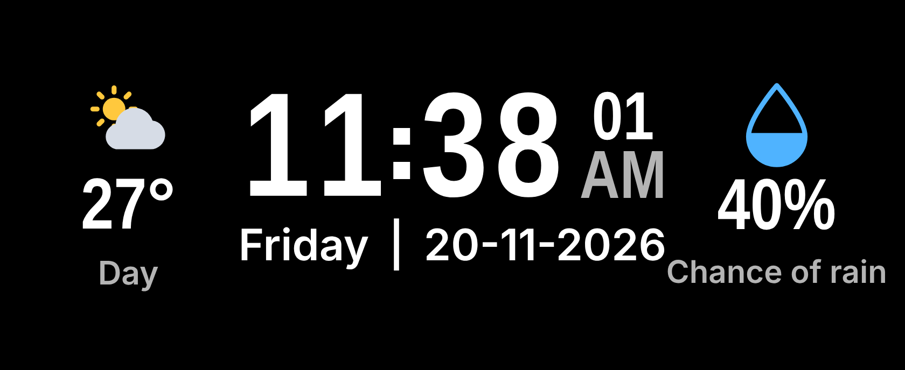
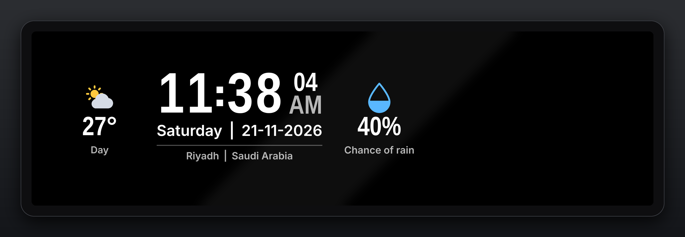

# xeneon edge clock weather widget

When I started using my XENEON EDGE, I couldn't find a single widget that combines the weather, time and date. Every widget is separate, and that gets annoying because you end up adding 3 or 4 widgets.

So I made a digital clock widget with weather for the XENEON EDGE, and I'm sharing it for free.

## Features

- Large digital clock with a small seconds counter next to the time
- Day and date on one line (e.g. Friday | 20-11-2026)
- Weather on both sides of the clock: current temperature and chance of rain, each with its own icon (on the square M size, the weather sits below the clock)
- Customizable from the widget settings:
  - 12-hour (AM/PM) or 24-hour clock
  - City: type your city name to search for it
  - Temperature unit: Celsius or Fahrenheit
  - Date type: Gregorian or Hijri calendar, with 9 different date formats
  - Colors: text, secondary text (AM/PM) and background
- Four sizes: S, M, L and XL
- Weather labels follow your system language

## Screenshots

| S | M |
| --- | --- |
|  |  |

| L |
| --- |
|  |

## Installation

1. [Download clock-and-weather.icuewidget](https://github.com/Nawaf-NM/xeneon-edge-clock-weather-widget/raw/main/clock-and-weather.icuewidget) (version 0.0.1)
2. In iCUE, import the widget
3. Add it to your XENEON EDGE screen and pick the size you like

Requires iCUE 5.47 or newer on Windows.

## Notes

- **Privacy:** The widget sends the selected city's coordinates to Open-Meteo to get the weather, and sends the city names you type to Open-Meteo's search to find your city. It also reads your approximate location from iCUE to pick the default city. There is no API key, no account and no tracking in the code. The widget is only allowed to contact open-meteo.com.
- **Weather data:** provided by [Open-Meteo.com](https://open-meteo.com/) under [CC BY 4.0](https://creativecommons.org/licenses/by/4.0/).
- **Trademarks:** Corsair, iCUE and XENEON EDGE are trademarks of their respective owners. This widget is unofficial and is a personal project of mine.

## Contact

You can contact me through my accounts here: https://Nawaf-Blog.com/NM
