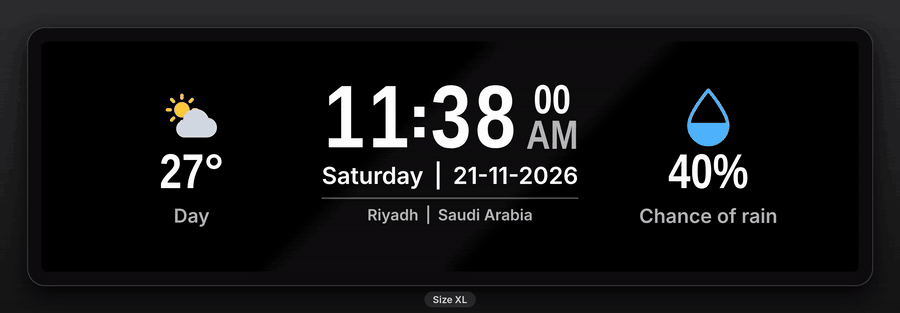
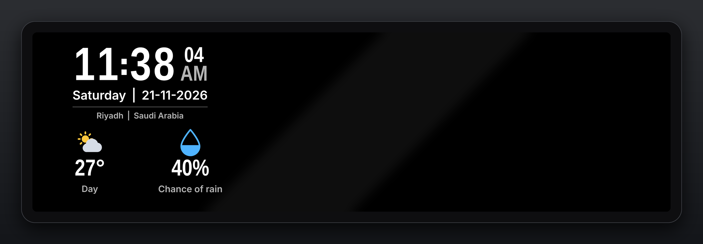
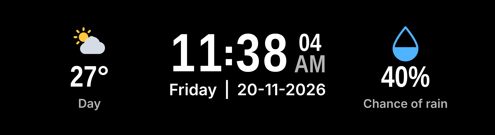

# Clock and Weather widget for CORSAIR XENEON EDGE

A digital clock and weather widget for the CORSAIR XENEON EDGE that brings the time, date and weather together in one widget. It shows a clock in 12-hour or 24-hour format with seconds, the day and date (Gregorian or Hijri) with your city name underneath, and the current weather: temperature, day or night, and the chance of rain. When you tap the screen, it switches to the weather details: feels-like temperature, humidity, wind speed, sunrise and sunset, and then returns to the clock automatically.

In the settings you can type your city name and change the temperature unit, the date format, the details duration and the colors. It comes in four sizes (S, M, L and XL), the weather labels follow your system language, and it needs no API key, no account and no tracking.

## Features

- Large digital clock with seconds, 12-hour or 24-hour
- Day and date on one line, with the city name under it
- Weather on both sides of the clock: temperature and chance of rain
- Tap the widget to open a weather details screen: feels like, humidity, wind speed, sunrise and sunset. Tap again to go back, or it returns by itself after the time you choose
- Everything is customizable in the widget settings: city (type your city name), temperature unit, Gregorian or Hijri date with many formats, weather details duration, and colors
- Four sizes: S, M, L and XL
- Weather labels follow your system language

## Screenshots

| S | M |
| --- | --- |
|  |  |

| L | XL |
| --- | --- |
|  |  |

## Installation

- Download the .icuewidget file from the link below
- In iCUE, import the widget
- Add it to your XENEON EDGE screen and pick the size you like

## Requirements

- iCUE 5.47 or newer
- Windows
- Not tested on Mac

## Download

- [Releases page](https://github.com/Nawaf-NM/Clock-Weather-Widget/releases)

## Notes

- **Privacy:** The widget sends the selected city's coordinates to Open-Meteo to get the weather, and sends the city names you type to Open-Meteo's search. It reads your approximate location from iCUE to pick the default city. There is no API key, no account and no tracking in the code.
- **Weather data:** provided by [Open-Meteo.com](https://open-meteo.com/) under [CC BY 4.0](https://creativecommons.org/licenses/by/4.0/).
- **Trademarks:** Corsair, iCUE and XENEON EDGE are trademarks of their respective owners. This widget is unofficial and is a personal project of mine.

---

## Update: version 0.0.2 is out!

- Tap the widget to open a weather details screen: feels like, humidity, wind speed, sunrise and sunset. Tap again to go back, or it returns by itself after the time you choose.
- New setting: weather details duration (5, 10, 15 or 30 seconds, 1 minute, or until you tap again).
- Your city and country are now shown under the date.

## Contact

You can contact me through my accounts here: https://Nawaf-Blog.com/NM
